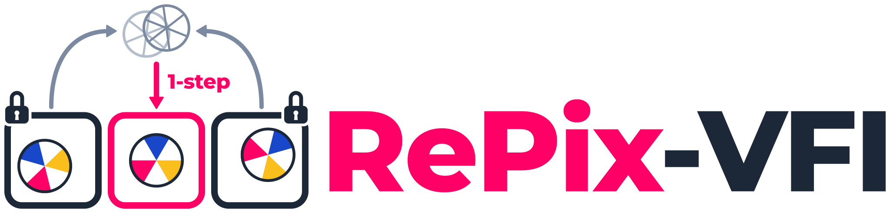
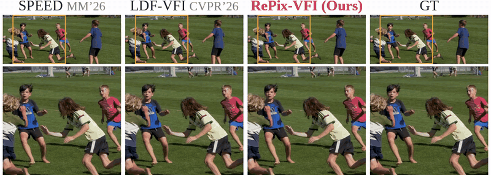
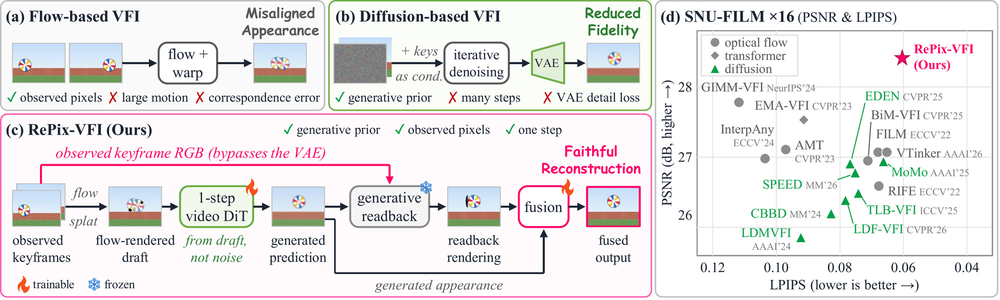
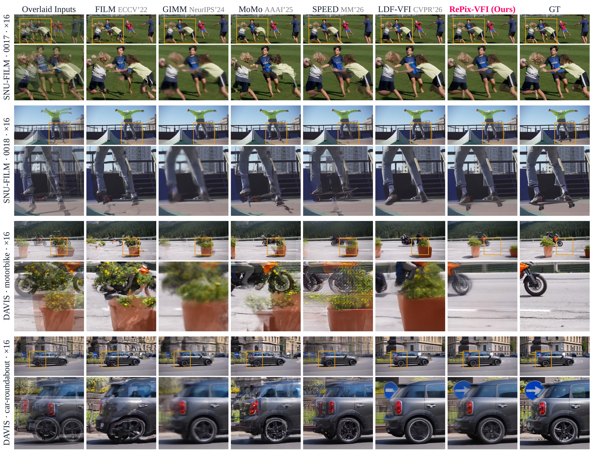
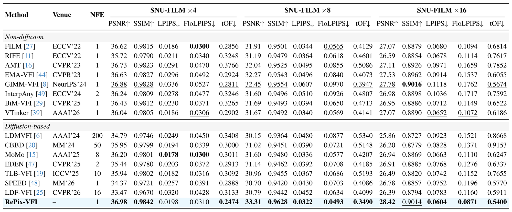
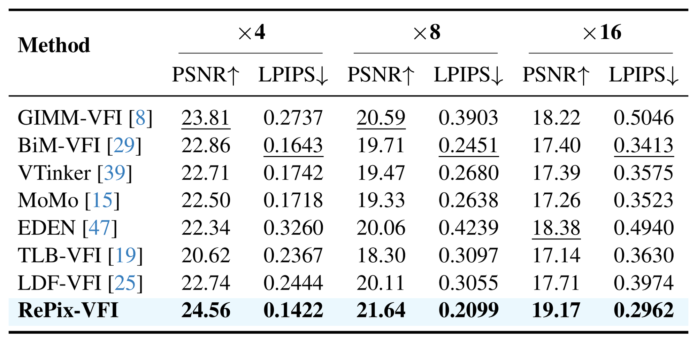
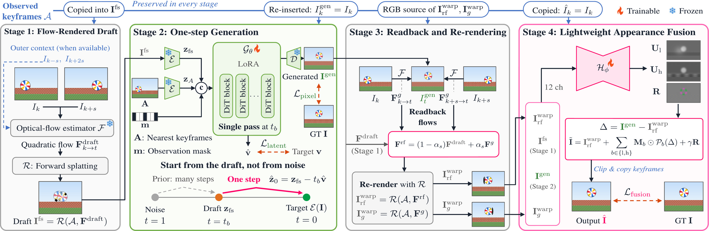

<p align="center">
  <picture>
    <source media="(prefers-color-scheme: dark)" srcset="assets/logo_dark.svg">
    
  </picture>
</p>

<div align="center">
<h2>RePix-VFI: Re-rendering Observed Pixels for Video Frame Interpolation with Generative Priors from One-Step Diffusion</h2>

<div>
    <a href='https://scholar.google.com/citations?user=Qh--APMAAAAJ' target='_blank'>Dayeon Kim</a>&nbsp;&nbsp;&nbsp;&nbsp;
    <a href='https://jeonghyeokdo.github.io/' target='_blank'>Jeonghyeok Do</a><sup>†</sup>&nbsp;&nbsp;&nbsp;&nbsp;
    <a href='https://www.viclab.kaist.ac.kr/' target='_blank'>Munchurl Kim</a><sup>†</sup>
</div>
<div>
    Korea Advanced Institute of Science and Technology (KAIST), South Korea
</div>
<div>
    <sup>†</sup>Co-corresponding authors
</div>
<br>
<div>
    <h4 align="center">
        <a href="https://kaist-viclab.github.io/RePix-VFI_site/" target='_blank'></a>
        <!-- ARXIV_BADGE_START --><!-- ARXIV_BADGE_END -->
        
    </h4>
</div>
</div>

---

<div align="center">
    <h4>
        This repository is the official implementation of "RePix-VFI: Re-rendering Observed Pixels for Video Frame Interpolation with Generative Priors from One-Step Diffusion".
    </h4>
</div>

<div align="center">
    <a href="https://kaist-viclab.github.io/RePix-VFI_site/" target='_blank'>
    
    </a>
    <p><sub>&times;16 interpolation on SNU-FILM, played 3&times; slower: SPEED, LDF-VFI, <b>RePix-VFI (Ours)</b> and the ground truth, with the full frame above and an enlarged crop below.</sub></p>
    <p>▶️ <a href="https://kaist-viclab.github.io/RePix-VFI_site/" target='_blank'><b>15 comparison videos on the project page</b></a> (with FILM, GIMM-VFI and MoMo as well)</p>
</div>

## 📧 News
- **Nov 2026:** This repository is created. The code will be released soon.

## 📖 Abstract
Multi-frame video frame interpolation (VFI) aims to reconstruct dense video from sparse keyframes, requiring accurate intermediate motion and faithful appearance. As temporal gaps grow, flow-based methods can retain observed textures but misplace them under ambiguous motion, whereas iterative latent-diffusion models can synthesize plausible content but incur substantial sampling costs and may alter details during reconstruction with a variational autoencoder (VAE). We present **RePix-VFI**, named for **Re**-rendering observed **Pix**els, a multi-frame VFI framework that couples draft-conditioned one-step video diffusion with reconstruction from observed keyframes. A pretrained video diffusion model refines a flow-rendered draft of the whole window in a single forward pass. For each target frame, our *generative readback* matches its two bounding keyframes to the generated prediction using an optical-flow estimator. The resulting correspondences guide re-rendering of original keyframe RGB pixels outside the VAE. A lightweight appearance fusion head combines these renderings with generated appearance. Experiments on benchmark datasets demonstrate significant improvements in reconstruction and perceptual quality. On SNU-FILM at ×8 and ×16, RePix-VFI achieves the highest PSNR and the lowest LPIPS, FloLPIPS, and tOF among the compared methods, exceeding the best evaluated diffusion-based baseline by 1.71 and 1.48 dB in PSNR, respectively. It also runs 32–42× faster than the state-of-the-art multi-frame VFI diffusion model.

## 📊 Results

### Reconstruction and Perceptual Quality
<div align="center">
    
</div>
<p align="center"><sub><b>Figure 1. RePix-VFI re-renders observed pixels using a one-step generated video as the correspondence reference.</b> (a) Flow-based VFI transports observed appearance but can misplace details under inaccurate correspondences. (b) Diffusion-based VFI draws on generative priors but typically requires iterative denoising and can lose observed details in VAE reconstruction. (c) RePix-VFI refines a flow-rendered draft in a single forward pass; the completed prediction provides correspondence references for re-rendering original keyframe RGB outside the VAE and supplies complementary appearance for fusion. (d) On SNU-FILM &times;16, RePix-VFI achieves both the highest PSNR and the lowest LPIPS among the compared methods.</sub></p>

### Qualitative Comparison
<div align="center">
    
</div>
<p align="center"><sub><b>Figure 3. Qualitative comparisons at &times;16.</b> The top two examples are from SNU-FILM and the bottom two from DAVIS, all at the midpoint between observed keyframes (&tau; = 8/16). The first column shows an equal-weight overlay of the bounding observations; subsequent columns show predictions and GT. Boxes indicate the regions enlarged below.</sub></p>

### Quantitative Comparison
On SNU-FILM at &times;8 and &times;16, RePix-VFI achieves the highest PSNR and the lowest LPIPS, FloLPIPS, and tOF among the compared methods, exceeding the best evaluated diffusion-based baseline by 1.71 and 1.48 dB in PSNR.

<div align="center">
    
</div>
<p align="center"><sub><b>Table 1. Quantitative comparison on SNU-FILM under the entire-video protocol.</b> Frame metrics are evaluated on missing frames from 31 clips; tOF uses all adjacent frame pairs. <b>Bold</b> and <ins>underlined</ins> values mark the best and second-best results. NFE is reported per synthesized frame, except per chunk for LDF-VFI and per window for RePix-VFI.</sub></p>
<br>
<div align="center">
    
</div>
<p align="center"><sub><b>Table 2. Quantitative comparison on DAVIS 2016.</b> PSNR and LPIPS on missing frames from all 50 sequences at their native resolutions.</sub></p>

More results and videos: [project page](https://kaist-viclab.github.io/RePix-VFI_site/).

## 🖼️ Method Overview

<div align="center">
    
</div>

RePix-VFI couples draft-conditioned one-step video diffusion with reconstruction from the observed keyframes.
- **Flow-rendered draft.** A flow-based renderer builds a draft of the whole window from the observed keyframes.
- **One-step generation.** A pretrained video diffusion model refines the draft latent in a single forward pass, conditioned on the observations and their temporal mask.
- **Generative readback and re-rendering.** For each target frame, an optical-flow estimator matches its two bounding keyframes to the generated prediction; the correspondences re-render the original keyframe RGB outside the VAE.
- **Appearance fusion.** A lightweight head combines the re-rendered and generated appearance through spatial mixing and a residual correction.

## 🚀 Code Release Plan
**The code and pretrained models will be released soon.**

- [ ] Inference code
- [ ] Pretrained models
- [ ] Training scripts
- [ ] Evaluation scripts

## 📑 Citation
If you find RePix-VFI useful, please consider citing:
```BibTeX
@article{kim2026repixvfi,
  title={RePix-VFI: Re-rendering Observed Pixels for Video Frame Interpolation with Generative Priors from One-Step Diffusion},
  author={Kim, Dayeon and Do, Jeonghyeok and Kim, Munchurl},
  journal={arXiv preprint arXiv:XXXX.XXXXX},
  year={2026}
}
```
